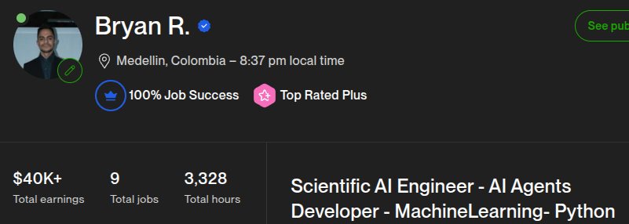
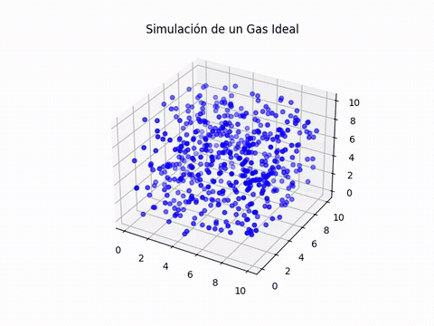
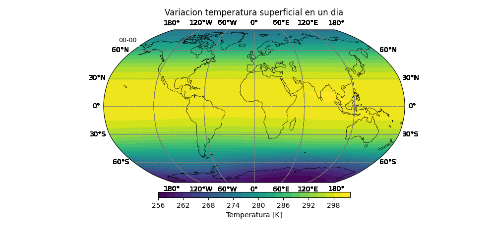
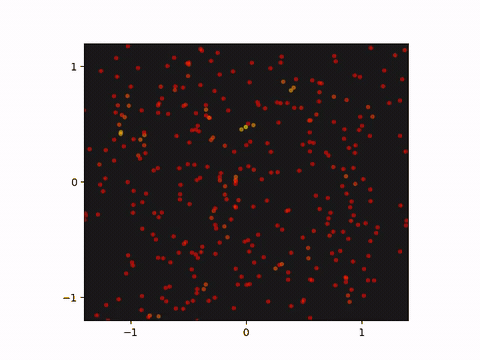
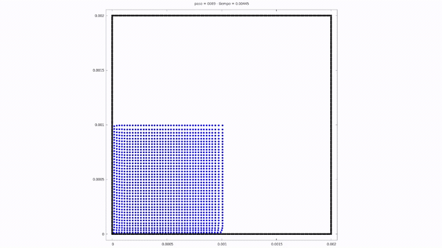
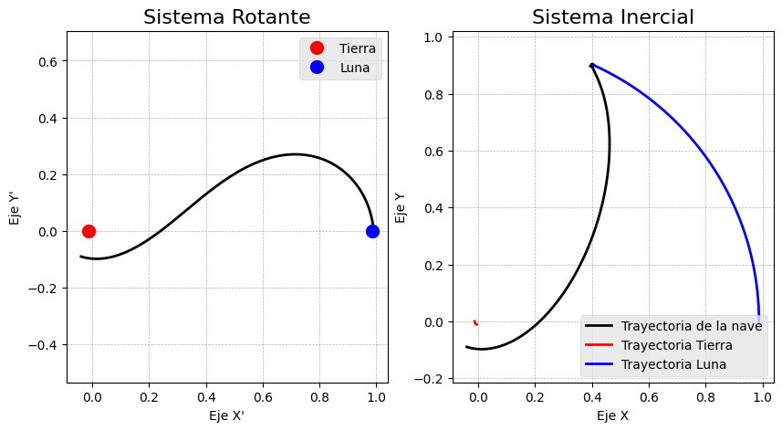
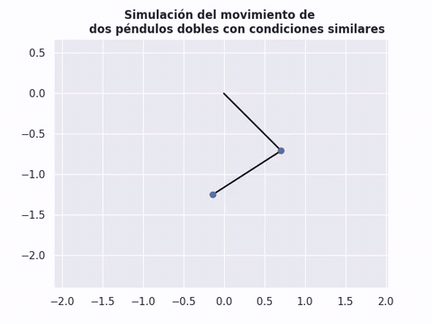
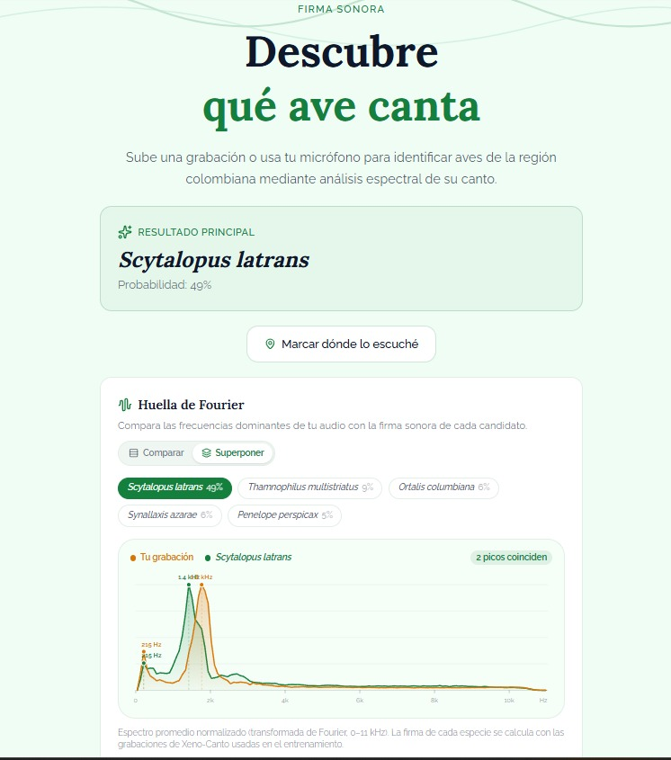

  

Hi, to whoever felt like reading this.

I'm Bryan. I'm in my last year of astronomy at the Universidad de Antioquia, in Medellín, Colombia. I've also been inside the world of modern digital technology for a while, finding my way in before OpenAI put large language models on the market and changed the reality we live in. Before that boom I sat down and learned to program, with Python as the core, and I never really left it.

When the models arrived, they let me walk into parts of the industry I hadn't touched. I started in data science, then I found backend work, and web development pushed along by AI. From the first models I have stayed close, watching firsthand how each part of society has been changing, including me. Over the years that turned into real projects. They formed me mainly as a scientist, but one who stays next to what a normal business, the kind that has to make money, actually needs. I learned how a business thinks. And I bring ideas that come from being curious and restless, even into businesses that look like physics has nothing to give them. The logical structure that science stands on is still very good for understanding the logic of a business.

The equation that won't leave me alone, as a scientist:

$$
R_{\mu\nu} - \frac{1}{2} R g_{\mu\nu} + \Lambda g_{\mu\nu} = \frac{8\pi G}{c^{4}} T_{\mu\nu}
$$

Some of the experiments I did at the university:

## A gas, an atmosphere, a star

Particles in a box, one day of temperature on Earth, and a star falling in on itself. [Continuum mechanics](https://github.com/andromedalactea/Continuus_Mechanics).

| Ideal gas | Surface temperature | Collapse |
| --- | --- | --- |
|  |  |  |

A dam break, written in C. [Computational astrophysics](https://github.com/andromedalactea/ComputationalAstrophysics).

## Orbits, and a pendulum that won't repeat

A ship on the way to the Moon, and two double pendulums that start almost the same. [Celestial mechanics](https://github.com/andromedalactea/celestial_mechanics).

| Toward the Moon | Two pendulums, almost the same start |
| --- | --- |
|  |  |

## And one that left the classroom

[Aves Sonoras](https://aves-sonoras-b3bg.onrender.com/) listens to a recording and guesses which bird is singing, from the Fourier signature of the call. [Code](https://github.com/andromedalactea/fourier_birds_classification).

